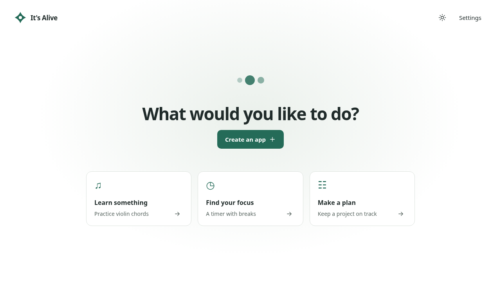
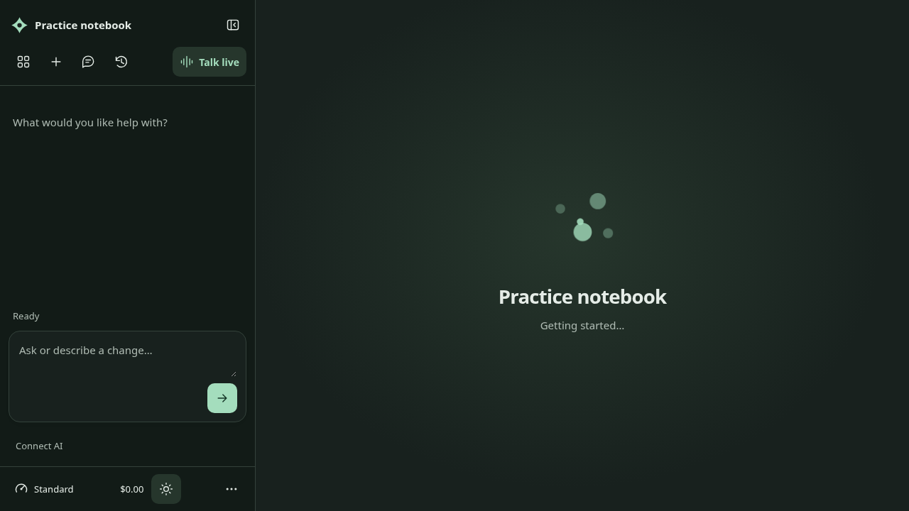

# October 2026 review implementation

Every private review record maps to implementation work below. The original transcript, backup and diagnostic files are retained in the private review; this repository contains engineering requirements and evidence only. There are 161 feedback records and 35 technical findings/recommendations, including positives, tentative ideas and overlapping concerns. The [coverage matrix](coverage.csv) preserves all 196 IDs.

## What changed

The review is implemented in [draft PR #183](https://github.com/sander-van-damme/itsalive/pull/183) on `codex/october-review`, based on `ebb347dd57576d8c43c3ab46be29f5bd481c9808`. The source and acceptance tests are reviewable together; production has not been deployed by this work. Local validation completed on 28 October 2026; the CI follow-up below was completed on 30 October.

- Full-screen welcome and a connection/spending setup replace the initial crowded chat/settings view. A collapsible left sidebar keeps live conversation, app switching, history, speed, spending and settings available. App-title renaming is separate. Appearance supports system/light/dark, including the platform starter.
- The companion receives actual app/source/state evidence, asks useful discovery questions for ambiguous goals, supplies selectable choices and resolves named-app references. Editable memory and general instructions are available to text and live conversation; delegated work receives relevant preferences.
- Generated-app policy rejects filler, redundant branding and inaccessible presentation. Computed contrast and accessible-name failures now return to the worker for repair before publication. This is targeted validation, not a full WCAG audit or proof of real-model design quality.
- Real progress messages and exact inspected-element overlays accompany timer/cancel. Failed live application retains a repairable candidate and verified rollback evidence. Retry preserves the goal, including failures before a build starts. Feedback and errors follow the actual outcome; queued cancellation stays cancellation.
- Recent apps retain mounted runtime state. Version restoration copies old source into a new version while keeping current saved data and later versions available. Starting/switching/restoring during work asks when to continue.
- Debug exports contain assembled prompts, responses, tool evidence, structured failures, build identity, retention/snapshot metadata and operation timing, with credentials removed. Backups preserve full usage/settings arrays and resumable drafts; partial data gets an explicit result.
- Hosted browser OAuth, credential storage, refresh and sign-out are implemented. Identity-only or narrowed grants cannot make allowance requests. Production still needs the provisioned hosted client/plan permission described below.

## Visual review

These captures show the actual shell and platform starter in Chromium with deterministic fixtures. They are not live-model generation evidence.

[Collapsed sidebar](screenshots/collapsed.png) · [Narrow-screen assistant](screenshots/mobile.png)

## Confirmed decisions

- Assistance belongs in a left sidebar, with icons available when collapsed.
- Work overlays must resolve exact inspected elements and leave unrelated content usable.
- Preferences and general instructions should follow researched conversational memory patterns, with user controls.
- Hosted ChatGPT allowance access should use a real OAuth grant and browser-persisted credentials. Provider registration requirements and unavailable account validation must be explicit.

## Implementation tickets

### T01 [#171 Move assistance to a collapsible left sidebar and add everyday controls](https://github.com/sander-van-damme/itsalive/issues/171)

The workspace should keep the app prominent while providing a familiar collapsible left sidebar. The owner has now confirmed left placement.

Acceptance:

- Expanded sidebar contains conversation and navigation; collapsed sidebar retains app, live conversation, chat, history and settings icons.
- Collapse/expand icon and accessible state change correctly.
- Spending estimate and Standard/Faster/Fastest controls stay available.
- App switching and renaming are distinct and discoverable.
- Shell supports system, light and dark appearance with keyboard/mobile accessibility.

Review references: FB-078–089, FB-120, FB-122–124, FB-133–134; S-08

Status: Implemented; deterministic acceptance passed. Pending review and release.

### T02 [#172 Replace first-run settings overload with a focused onboarding flow](https://github.com/sander-van-damme/itsalive/issues/172)

First arrival exposes a chat rail and a dense settings form before the user has an app. Create a focused goal-led onboarding flow with useful examples and visible setup steps.

Acceptance:

- Empty workspace has a focused full-screen start with concise inspiration.
- Preserve goal and optional name through setup, cancellation and successful connection.
- Setup asks for connection and optional spending control; advanced model choices remain in Settings.
- Provider help is shown for the selected provider only; connection checks use ordinary language.
- Settings groups connection, preferences, usage, backup and diagnostics; important actions fit narrow screens.

Review references: FB-002–005, FB-008, FB-011–026, FB-102–103, FB-111, FB-119; S-08

Status: Implemented; deterministic acceptance passed. Pending review and release.

### T03 [#173 Clarify ambiguous goals and inspect the actual app before proposing changes](https://github.com/sander-van-damme/itsalive/issues/173)

The companion starts building from ambiguous problem statements and asks users to describe observable app behavior. Separate authorization from understanding.

Acceptance:

- Ambiguous problem-led requests receive useful discovery before a solution is built.
- Concrete simple requests proceed without redundant approval.
- The companion receives actual app inspection/source/state when answering app questions.
- Offer relevant structured choices with a free-text alternative when choices materially help.
- Intent, supplied evidence and clarification decisions are traceable in debug logs.

Review references: FB-046–049, FB-054–058, FB-066–069, FB-127–132, FB-149–153; B-003, B-008; S-01–03

Status: Implemented; unit/browser acceptance passed. Real-model quality remains subject to the release limits below.

### T04 [#174 Add editable preference memory and general instructions with explicit scope](https://github.com/sander-van-damme/itsalive/issues/174)

Research established conversational memory patterns and implement persistent user-controlled preferences.

Acceptance:

- General instructions and remembered preferences are visible, editable and removable.
- Track explicit versus inferred preferences and app versus all-app scope.
- Update/deduplicate memory by topic over time without silently discarding explicit instructions.
- Worker tasks receive relevant preferences; raw account-wide memory stays with the companion.
- References to another app resolve actual saved app context, or explain unavailable context.
- Include primary-source research and validation of preference continuity across app creation.

Review references: FB-135–141; B-007; S-06

Status: Implemented; unit/browser acceptance passed. Real-model quality remains subject to the release limits below.

### T05 [#175 Enforce useful copy and accessible design in generated applications](https://github.com/sander-van-damme/itsalive/issues/175)

Generated apps repeatedly add invented branding, filler slogans, tiny low-contrast text and generic task flows. Generation needs an explicit product design contract and outcome checks.

Acceptance:

- Keep useful labels/instructions while removing filler slogans and redundant branding.
- Use readable typography, adequate contrast, focus visibility and accessible modal behavior.
- Distinct navigation destinations have distinct useful task flows.
- Preserve working audio, themes, activity and data during updates.
- Animation/audio respects user control and reduced motion; diagrams retain needed explanations.
- Validate representative generated interfaces and clearly separate fixture checks from real-provider evidence.

Review references: FB-036–037, FB-059–065, FB-090–094, FB-112–115, FB-118, FB-121, FB-125–126, FB-142–148, FB-154–156; B-004–008; S-05

Status: Implemented; unit/browser acceptance passed. Real-model quality remains subject to the release limits below.

### T06 [#176 Show meaningful progress, precise work overlays and coherent feedback](https://github.com/sander-van-damme/itsalive/issues/176)

Long-running edits show generic status, completion lacks useful explanation, and failures produce stale feedback or duplicate errors. The owner wants accurate overlays on affected elements.

Acceptance:

- Preserve timer/cancel while reporting truthful task-specific findings and progress.
- Use actual inspected element identities for work overlays; do not guess affected sections or blur the whole app.
- Completion states what changed in ordinary language after successful application.
- A failed/cancelled attempt does not display stale success feedback or duplicate failure messages.
- Do not silently repopulate the composer with a failed submitted prompt.
- Creating an app during work presents a stable explicit wait/cancel choice.

Review references: FB-027–035, FB-044, FB-050–058, FB-070–075, FB-095, FB-113, FB-116–117; D-011–014; S-04

Status: Implemented; unit/browser acceptance passed. Real-model quality remains subject to the release limits below.

### T07 [#177 Repair failed live application from saved evidence and preserve app activity](https://github.com/sander-van-damme/itsalive/issues/177)

A candidate can pass isolated verification and fail while updating the running app. Retry currently reapplies the same saved candidate without addressing that failure.

Acceptance:

- Preserve structured live-apply evidence and candidate work in recovery checkpoints.
- Retry selects a justified repair/recovery path instead of repeating an identical failed commit.
- Preserve the last working revision and distinguish rollback, cancellation and provider failure.
- Preserve ongoing activity across ordinary app switches and clean up resources predictably.
- Version restore retains later versions and explains source-versus-data scope.
- Cover live-update failure and recovery separately from cold candidate rendering.

Review references: FB-071–077, FB-096–101, FB-123–124; D-005–006, D-013; B-002, B-010–011

Status: Implemented; deterministic acceptance passed. Pending review and release.

### T08 [#178 Fix live voice protocol, connection diagnostics and usage accounting](https://github.com/sander-van-damme/itsalive/issues/178)

Live voice startup fails without useful connection evidence. Update the client/server contract to current documented GPT-Live behavior and separate observed timing from billing estimates.

Acceptance:

- Send prior conversation in the documented session input schema and handle current usage/delegation events.
- Keep live conversation available during delegated work and return grounded progress/results.
- Every failure/stop cleans up microphone, peer, channels and timers.
- Record correlated connection phases and sanitized provider errors.
- Apply any documented initialization estimate only to confirmed session creation, not merely attempted or rejected requests.
- Clearly mark measured time, estimated cost and unknown billing; test protocol and lifecycle failures.

Review references: FB-038–043, FB-085, FB-091, FB-095; D-002–004

Status: Implemented; unit/browser acceptance passed. Real-model quality remains subject to the release limits below.

### T09 [#179 Make debug exports reconstructable and identify the deployed build](https://github.com/sander-van-damme/itsalive/issues/179)

Debug mode currently records metadata while omitting prompts, responses, tool contents and exception causes. Exports also lack deployment identity and coherent snapshot metadata.

Acceptance:

- Explicit debug mode captures full assembled requests/replies and tool inputs/results with targeted credential redaction.
- Preserve useful exception message, cause, stack, stage and provider identifiers.
- Use separate local request, provider request, provider response and parent-operation IDs.
- Export a flushed coherent snapshot with cutoff, in-flight, retention and omission metadata.
- Include commit/build/client/server identity and expose a readable build entry in Settings.
- Validate these properties in realistic failure scenarios.

Review references: FB-006–007, FB-157–158; D-001–003, D-006–010, D-012–015

Status: Implemented; deterministic acceptance passed. Pending review and release.

### T10 [#180 Make workspace backups lossless for usage, settings and recovery drafts](https://github.com/sander-van-damme/itsalive/issues/180)

The portable backup silently truncates settings arrays to 100 items, losing usage rows, and omits recoverable coding drafts.

Acceptance:

- Preserve complete usage/settings/feedback values with targeted credential removal.
- Include and validate resumable coding checkpoints and needed dependency coverage.
- Verify a round trip of more than 100 records by IDs, counts and totals.
- Report meaningful omissions and warnings in machine-readable coverage.
- Show a concise human backup result with optional detail, not internal category jargon.
- Keep restore reversible through a prior backup and preserve established origin boundaries.

Review references: FB-104–110, FB-160; B-001–002, B-012

Status: Implemented; deterministic acceptance passed. Pending review and release.

### T11 [#181 Implement hosted browser ChatGPT allowance sign-in with documented OAuth grants](https://github.com/sander-van-damme/itsalive/issues/181)

The owner requires hosted browser sign-in using ChatGPT/Codex allowance, with credentials stored in the shell browser rather than requiring a local helper.

Acceptance:

- Research current official Codex/OAuth and plan-sharing contracts, including device flow where applicable.
- Implement a real PKCE/state/OIDC browser flow and refresh/signout for supported public-client configuration.
- Distinguish identity sign-in from a grant to consume plan allowance; do not silently fall back to API billing.
- Keep credentials out of diagnostics, generated apps and backups.
- Explain any genuinely required provider registration/configuration precisely and document setup.
- Test callback state, refresh, signout, rejected grants and provider-boundary behavior; label live-account verification accurately.

Review references: FB-009–010, FB-013–016; S-07

Status: Implemented and tested with account fixtures; hosted provider registration/grant and live validation remain open.

### T12 [#182 Validate the complete review with traceable acceptance evidence](https://github.com/sander-van-damme/itsalive/issues/182)

Carry every review item into implementation and verify the complete user workflow rather than counting passing compilation as product success.

Acceptance:

- Maintain an ID-to-ticket coverage matrix for every feedback and technical finding.
- Update product contract and milestones for the confirmed left sidebar and behavior changes.
- Run install, typecheck, unit, build and browser checks; inspect desktop/mobile light/dark screenshots.
- Cover goal creation, voice, clarification, progress, recovery, negative feedback, switching, settings and backup/restore.
- Preserve praised behavior and record unavailable real-provider or hosted-account verification honestly.
- Deliver reviewable branch/PR and remaining blockers without publishing private logs or transcript.

Review references: FB-001, FB-053, FB-104–105, FB-159–161; all preservation and acceptance requirements

Status: Deterministic validation passed; Windows incognito, live provider/account and deployment acceptance remain open.

## Validation

Validated on 28 October 2026 with Node 24.19.0 and Chromium on Linux:

| Check                   | Result                                                                                                       |
| ----------------------- | ------------------------------------------------------------------------------------------------------------ |
| Dependency installation | `npm ci` completed during implementation; lockfile unchanged                                                 |
| TypeScript              | `npm run typecheck` passed                                                                                   |
| Unit/regression tests   | `npm test`: 241 passed across 23 files                                                                       |
| Production builds       | Root and app builds passed; existing root bundle-size advisory remains                                       |
| Browser acceptance      | `npm run test:e2e`: 68 passed, 2 opt-in live-provider/CDN cases skipped                                      |
| Production assets       | `node scripts/production-smoke.mjs` passed: setup, generation, update, state/reload and no development hooks |
| Patch checks            | `git diff --check` passed                                                                                    |
| Actual provider         | Opt-in command attempted; no `OPENAI_API_KEY` supplied, so not run                                           |

The full run includes the quality-repair, voice/memory, OAuth/revocation, work overlay, live-apply rollback, queued cancellation, pre-build retry and history traversal cases. Desktop/mobile light/dark screenshots were inspected. A restore-test timing flaw was fixed by waiting for a non-null app; the data and visible restored-state assertions remain. The final combined run has no failures.

The first GitHub run passed TypeScript, all 241 unit tests and the builds, but exposed a timing flaw in the onboarding cancellation test. That test could dismiss the creation dialog before the native onboarding close event had reopened it, leaving Settings covered. It now waits for the restored dialog to be visible before dismissing it; the preserved-goal and no-stale-request assertions remain. On 30 October, the focused regression passed 12 consecutive runs and four related onboarding/settings/dialog cases passed. [Current PR checks](https://github.com/sander-van-damme/itsalive/pull/183/checks) record subsequent CI results.

Tests use deterministic provider replies and simulated microphone transport. They do not establish live account permissions, actual billing, real audio quality or arbitrary model output quality.

## Remaining release and acceptance work

1. **Hosted ChatGPT allowance:** obtain an OpenAI-issued public client with the exact `https://itsalive.org/auth/chatgpt/callback` URL and hosted plan permission, then validate login, refresh, inference and revocation against that account. Browser persistence is implemented. The blocker is an unavailable documented provider grant, not an assertion that browser storage or device-code HTTP mechanics are technically impossible. [Research and setup](../AUTH_RESEARCH.md).
2. **Real-provider and Windows voice:** this environment has no supplied OpenAI API key, hosted registration or physical Windows microphone. The opt-in live command reports verification unavailable. Run the original Windows incognito journey after deployment, including real audio and allowance/cost behavior.
3. **Generated quality:** real-model empathy, no-filler writing, task relevance, useful audio/3D and full accessibility still require live acceptance. Current automated checks inspect rendered views; they do not navigate every route or certify keyboard/focus behavior. [Exact quality coverage](../GENERATED_QUALITY.md).
4. **Progress and continuity boundaries:** semantic updates require real worker findings; a long provider response can still have only a stage/timer. No real-provider latency improvement is claimed. Four recent apps retain runtimes; durable state is required across eviction, reload and backup. [Runtime behavior](../RUNTIME_RECOVERY.md).
5. **Deployment:** review/merge/release is separate. The initial downloaded logs cannot acquire missing historical exceptions or billing evidence retroactively. All issues stay open for review and remaining live acceptance rather than being bulk-closed from deterministic test counts.

## Research and evidence

[Memory patterns and controls](../MEMORY_RESEARCH.md) · [Live voice protocol and accounting correction](../LIVE_VOICE_RESEARCH.md) · [Backup completeness](../backup.md) · [Full acceptance contract](../acceptance.md)

The original analysis's minimum-charge conclusion was corrected after primary-source research: OpenAI documents initialization billing for successfully created live sessions. Rejected creation is not a confirmed billable session; transport-ambiguous creation remains unknown. The old test's actual voice charges cannot be reconstructed from its incomplete export.
